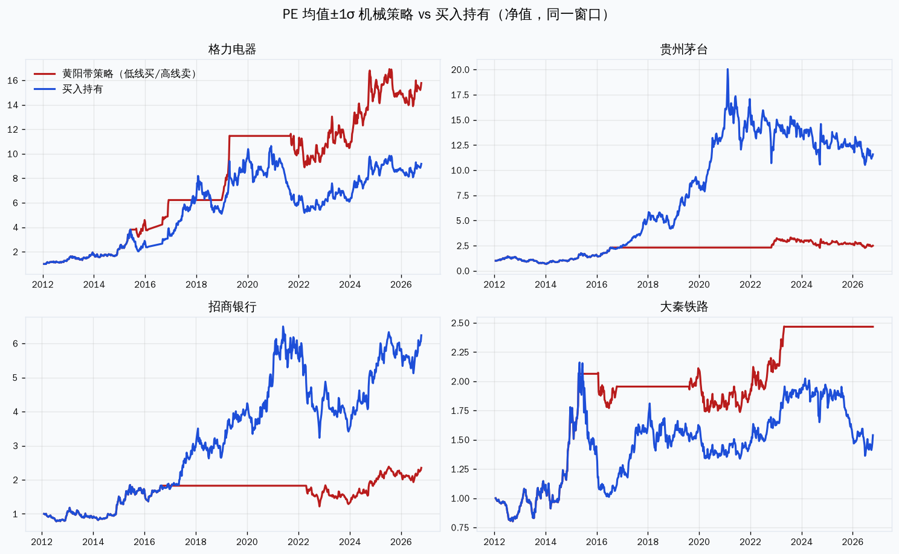
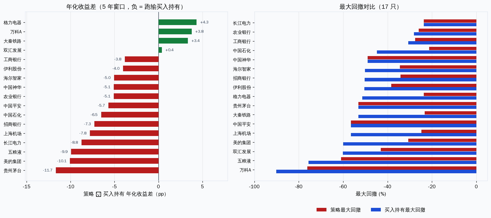
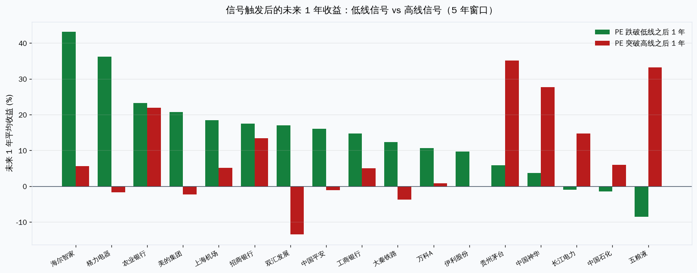
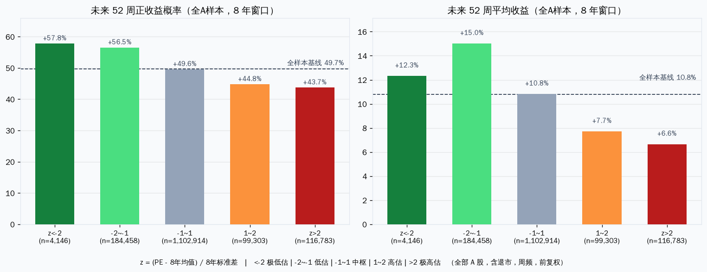
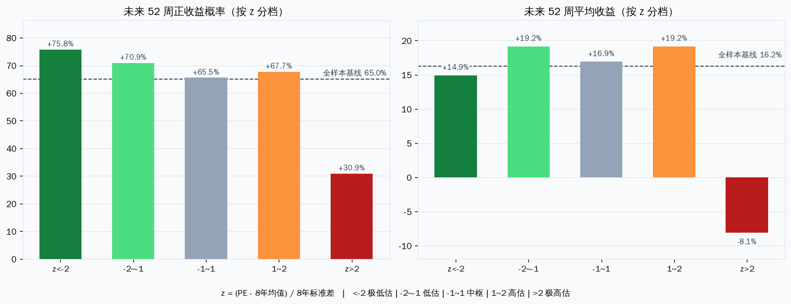

# 黄阳 PE 带：现在不是买入信号

按他自己的尺子，此刻不是“市场可以买”。低买高卖翻译成机械规则之后，在他点名的那类稳定公司上，5 年滚动窗口平均每年跑输买入持有 **4.6 个点**，换来的是回撤从 -52% 收到 -38%。他的概率说法方向是对的，但“红线上方涨跌大约 3:7”只在蓝筹、而且已经偏离到两个标准差时才对得上，不能当成全市场的买入许可证。

截至 2026-10-14 收盘、用他视频里常用的 **8 年窗口**：该加大关注的只有贵州茅台和中国平安；已经站在高估线上方的是农业银行、工商银行、中国神华、大秦铁路。招商银行在中枢，没有信号。比亚迪、宁德时代、科创芯片不在这套方法的适用域里。

---

## 他实际说的是什么

来源是 `~/huangyang-methodology` 里的文字稿，不是网上转述。核心在三篇：

- 2025-03-07《如何用正态分布的思路，去判断公司市盈率高低》：历史 PE 大致呈钟形；均值线、均值减一个标准差（低估线）、均值加一个标准差（高估线）。绿线加大关注，红线有高估风险。标准差用的是 Excel `STDEV.P`。
- 2022-10-21 茅台数学文：高于红线不是“一定会跌”，是上涨概率和下跌概率大约 3:7。一个标准差覆盖约 68%。**只适用于竞争格局清楚、利润稳定的成熟公司，不适用于成长股。**
- 2024-12-27 农行复盘：低估时建仓、高估时减仓，是在做概率，不是在预测。他明确说均值回归的概率会加大，但不一定会发生。

窗口在他的图上通常是近 8 年，有时拉到 10 年。他做的是仓位倾斜，不是全仓进出。

`~/` 下没有现成的黄阳回测项目。`~/stock-scripts-repo` 是另一套动量和横盘突破（Heaven's Light、云梯、pingban）。`~/grouth-trend` 是 CAN SLIM 趋势回测。能复用的是本地 Postgres（`stock-data-service`，含退市股，2005 至 2026-10-14）。

## 翻译成规则时做了什么

两套检验，分开报，不混成一个“策略好不好”。

1. **机械版**（比他本人更硬）：周频 PE(TTM)，滚动均值和总体标准差。PE 跌破低估线满仓，升破高估线清仓，信号下一周生效。成本按换手 0.1% 扣。窗口测了 5 年（260 周）和 8 年（416 周）。这是把他的“加大关注 / 降低仓位”推到极端，用来看上限，不是复述他的原话。
2. **概率版**（更贴近原话）：不交易，只统计 PE 落在各档之后，未来 26 周和 52 周的收益与上涨概率。全 A 样本 5,888 只、342.9 万周，含 340 只退市股，避免只拿活下来的蓝筹说话。

亏损（PE≤0）不进均值和标准差。没有用未来数据：每一周的线只用这一周之前的 PE。

年化收益按比较窗口的起点归一。第一版把窗口开始之前的涨幅也算了进去，会把买入持有的年化抬高、把策略的落后夸大。下面的数字是修正后的。

## 低买高卖，跑不赢拿着

17 只是他视频里反复用的稳定公司，加上他自己当反面教材的大秦铁路，再加万科、平安、海尔、双汇、机场、石化，用来看方法在“不该用”的地方会不会爆。

5 年窗口，2012 年前后起算到 2026-10-14：

| | 策略 | 买入持有 |
|---|---|---|
| 平均年化 | 6.2% | 10.9% |
| 年化差 | 平均 -4.6 个点，中位数 -5.1 | |
| 跑赢只数 | 4/17（格力 +4.4，万科 +3.8，大秦 +3.4，双汇 +0.4） | |
| 平均最大回撤 | -38% | -52% |
| 回撤更小 | 13 只更好，4 只一样，0 只更差 | |

8 年窗口差距收窄到平均 -2.5 个点，6/17 跑赢，回撤仍是 -37% 对 -52%。把带宽从 1 个标准差改成 0.5 或 1.5，5 年窗口的落后分别是 -3.9 和 -8.2 个点，没有一个参数能翻过来。

等权把这 17 只合成一个组合（2016-10 至 2026-10，空仓收益按 0）：策略累计 +45%、年化 3.8%、最大回撤 -10%；买入持有累计 +196%、年化 11.5%、最大回撤 -25%。

亏在卖出，不在买入。若只在第一次跌破低估线时买入、之后一直拿到现在，17 只平均年化 9.9%，和买入持有的 10.9% 几乎贴在一起。一旦加上“破高估线就卖”，2017、2019、2020 这三年的利润大部分拿不到：那三年策略的平均年度收益是 +12%、+8%、+0.3%，买入持有是 +69%、+45%、+22%。2018 和 2022 策略确实少亏（约 0 和 +5%，对照 -14% 和 -3%），补不回那三年。

跑赢的三只有一个共同点：买了之后没有走出长期复利。格力是来回震荡、带状交易能吃到波段；大秦铁路是他点名的低估值陷阱，高估线卖掉避开了后面的阴跌；万科是少亏，不是多赚。茅台是反面：5 年窗口策略年化 6.4%，拿着是 18.1%，回撤却一样是 -53%——卖在高估线之后，跌的时候已经空仓过晚，涨的时候又没在车上。

## 概率说法：方向对，3:7 对不上

全 A、8 年窗口、未来 52 周。基线是上涨概率 49.7%、平均收益 +10.8%、中位数约 0。

| z 档 | 样本周数 | 上涨概率 | 平均收益 | 中位数 |
|---|---|---|---|---|
| < -2 极低估 | 4,146 | 57.8% | +12.3% | +5.0% |
| -2 到 -1 低估 | 184,458 | 56.5% | +15.0% | +4.8% |
| -1 到 1 中枢 | 1,102,914 | 49.6% | +10.8% | -0.3% |
| 1 到 2 高估 | 99,303 | 44.8% | +7.7% | -4.4% |
| > 2 极高估 | 116,783 | 43.7% | +6.6% | -5.4% |

低估比中枢好，高估比中枢差，单调性在。但幅度是 7 个点的概率差，不是 7:3。极低估（z < -2）的平均收益（+12.3%）还不如普通低估（+15.0%），左尾没有“越便宜越好”。

换成他的股票池，极端高估才出现他说的 3:7：17 只里 z > 2 的周，下一年上涨概率 30.9%、平均 -8.1%。但这是重叠的周，茅台 2017 到 2021 年可以连续几十周都算“高估”，不能当成几百次独立下注。第一次摸到高估线（z 刚超过 1）之后的一年，这 17 只仍有 66.7% 是涨的。全 A 上，第一次跌破低估线之后一年上涨概率 57.3%（n=12,957），第一次升破高估线是 46.2%（n=14,439）。中位数分别是 +5.5% 和 -3.5%。

均值回归发生在 z 本身，不自动变成股价下跌。z > 1 之后 52 周，83.6% 的 z 会下降，67.6% 回到 1 以内，但只有 40% 回到 0 以下。估值可以“回归”而股价继续涨，只要利润涨得更快。这就是茅台、美的在高估线上还在赚钱的原因。

市值前 30% 的子集方向相同、更干净：低估档一年上涨概率 53%–56%，极高估档 38%。z 和未来一年收益的 Spearman 相关是 -0.09。有关系，很弱。

## 此刻这 17 只在哪

8 年窗口，截至 2026-10-14。z = (PE − 8 年均值) / 8 年标准差。

| 位置 | 标的 | PE | 低估线 | 高估线 | z |
|---|---|---|---|---|---|
| 低估线以下 | 中国平安 | 5.82 | 7.47 | 10.88 | -1.97 |
| 低估线以下 | 贵州茅台 | 19.74 | 22.29 | 45.24 | -1.22 |
| 中枢 | 招商银行 | 7.09 | 5.97 | 10.84 | -0.54 |
| 中枢 | 海尔智家 | 10.68 | 9.81 | 22.90 | -0.87 |
| 高估线以上 | 农业银行 | 8.44 | 4.48 | 7.21 | +1.89 |
| 高估线以上 | 大秦铁路 | 16.71 | 7.30 | 13.66 | +1.96 |
| 高估线以上 | 工商银行 | 8.05 | 4.90 | 6.96 | +2.05 |
| 高估线以上 | 中国神华 | 20.31 | 7.70 | 14.60 | +2.65 |

5 年窗口会把海尔也划进低估（PE 10.68，低线 11.60）。他视频里画的是 8 年，以 8 年为准，海尔仍在中枢。万科 PE 已无效（利润为负，线画不出来）。上海机场 8 年标准差被疫情亏损年拉到 107，低估线是负的，这根尺子在基本面失稳时会失灵——这正是他自己写过的限制。

平安和茅台的“低估”也不能直接当成买点。平安的 PE 受投资收益扰动，他讲保险时用的是营运利润，不是净利润。茅台这边，利润平滑的储备在 FY2025 已经耗尽，基本面并不处于“共识稳定”的状态。两只都在线上，但都踩着他自己的适用条件边界。

## 对你的持仓

这套方法回答不了“今天该不该买比亚迪 / 宁德 / 芯片”。他白纸黑字说成长股不要用 PE 正态带。招行在 8 年窗口的中枢（z = -0.54），既不是加关注，也不是减仓。

若只用这把尺子做仓位，此刻的动作是：银行里的农行、工行，以及神华、大秦，处于他定义的高估侧，不追；茅台和平安可以放进观察，但要先过基本面那一关，过不了就只是“便宜的 PE”，不是他的信号。用它来给当前这个成长股为主的组合找买入理由，是用错尺子。

## 算上调仓

他没有说破线就清仓。2025-06-22 讲指数估值时的仓位是：低估线以下尽量满仓，均值附近降到 70% 左右，高估线以上降到 50% 以下。同一篇里还有组合再平衡：卖掉贵的，买入便宜的，并留大约 10% 现金。两条都按 8 年窗口、信号下一周生效、换手 10 个基点重算。

单只股票按 100% / 70% / 50% 三档持有，不满仓进出：平均年化 8.2%，对照拿着的 10.1%，仍落后 1.9 个点。回撤 -40%，对照 -52%。把三个锚点连成线性仓位，落后缩到 0.9 个点，17 只里 9 只打平或跑赢，中位数约 0。高估侧降到 30% 而不是 50%，更差。伤害仍然来自少持有，不是来自调得不够狠。

组合里把卖掉贵的钱买成便宜的，才是调仓，不是空仓。2016-10 至 2026-10-14，等权拿着年化 11.5%、回撤 -26.5%；按估值倾斜、资金全投进去，年化 10.7%、回撤 -26.0%。没有再平衡超额，回撤也没下来。加上 10% 现金备用，年化再掉到 9.7%，回撤只收到 -23.6%。5 年窗口的倾斜更差（10.1% 对 12.0%），回撤还略大。

这和他另一句话一致：区间里高抛低吸，长期对收益率影响不大，仓位管理是锦上添花。调仓比上一节的清仓好，是因为它少卖，不是因为它多赚。

按 8 年带、留 10% 现金，此刻的倾斜权重大致是：平安和茅台各约 11%，中枢的（含招行）各约 6%，农行、工行、神华、大秦各约 3%。万科没有有效 PE，不在这本账里。平安和茅台的基本面保留意见不变，权重大不改变那条限制。

若改成固定仓位：留 20% 现金，每只 8%，最多 10 只（20%+10×8%=100%）。2016-10 至 2026-10-14，8 年带，每周持有 z 最低的 10 只：年化 9.2%、回撤 -17.5%。对照只是把等权组合打八折、同样留 20% 现金：年化也是 9.2%、回撤 -20.0%。选股没有多赚钱，20% 现金本身就吃掉大约 2 个点（等权满仓是 11.4%、回撤 -24.7%）。只允许买低估线以下的，每只仍 8%：平均只持有 2.1 只，年化 1.9%，回撤 -7.2%，空仓是主因。5 年带的 10 只版本略差于“只留现金”（8.9% 对 9.2%）。

按最新一周的 8 年 z，这 10 只会是：平安、茅台、伊利、海尔、双汇、招行、格力、五粮液、上海机场、美的。长江电力及更贵的不在里面。上海机场的标准差被疫情年拉爆，z 仍把它排进前 10，这是尺子失灵，不是便宜。

每支 8% 不是 15 只。满仓每只 8% 大约是 12 只（100/8=12.5）；15 只满仓每只约 6.7%。15×8%=120%，不加杠杆放不下。留 20% 现金时，8% 仍然只能放 10 只。

把换股改成每 26 周一次，或遇到强信号才换（持仓 z>+1 卖出，未持仓 z<-2 才换入；信号用上一周的 z）。在能真正挑 12 或 15 只的池子里——沪深 300 成分、且 8 年 PE 带有效——等权拿着年化 4.4%、回撤 -31%。12 只、只按半年换：年化 0.4%、回撤 -45%。15 只、只按半年换：年化 -0.4%、回撤 -40%。加上强信号，12 只年化 2.4%、15 只年化 1.4%，回撤仍在 -40% 附近。换得慢没有补回落后，回撤还更大。

在原来那 17 只里拿 15 只，几乎就是全拿着（12.0% 对 12.0%）。拿 12 只（对应每只约 8%）降到 10.1%。池子只有 17 只时，所谓强信号 10 年触发了 294 次，已经不是“偶尔才动”。

按 2026-10-14 的 8 年 z，沪深 300 里最低的 15 只扎在券商和保险：广发、平安、招商证券、宝丰能源、东鹏饮料、恒瑞、金龙鱼、中金、山金国际、太保、新华、中信证券、东方证券、巨人网络、中国人寿。这是同一根尺子排出来的名单，不是分散后的组合。

## 边界

- 机械版是压力测试。他本人是倾斜仓位，不是全进全出。只买不卖的变体几乎追平买入持有，说明伤害来自卖出规则。
- 全 A 的周次大量重叠，概率表里的 n 是上限。独立一些的算法是“第一次越线”，文中已分开报。
- 空仓收益按 0，没有算货基。加上货基，策略的落后会小一点，翻不了盘。
- 17 只是他的例子，天生是幸存者。全 A 含退市，边缘更薄，这才是方法的真实强度。
- 代码在本目录 `scripts/`。行情来自本地 `stock_daily`（导出日 2026-10-15，数据截至 2026-10-14）和 TuShare 缓存。周频标签记在周五，最后一根是 10 月 16 日那一周，里面的收盘是 10 月 14 日。

---
Data as of: 2026-10-14
Generated: 2026-10-15
