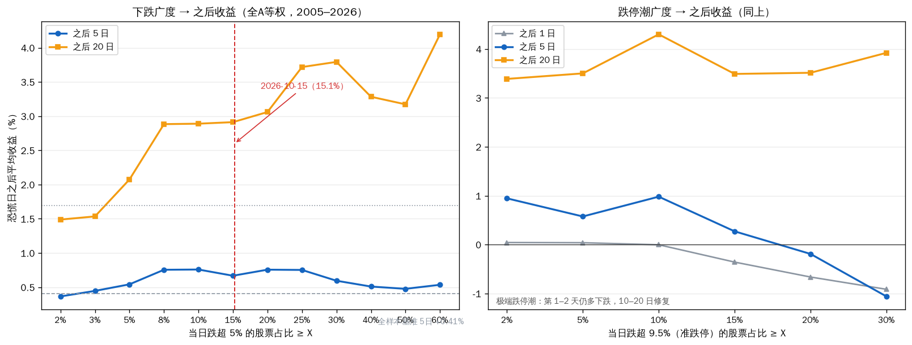
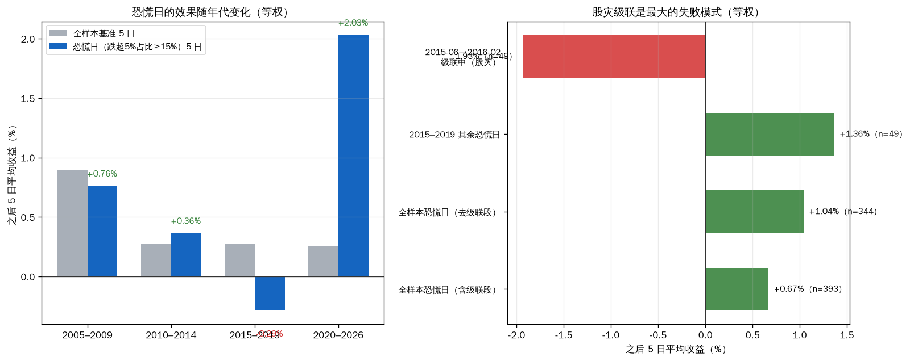
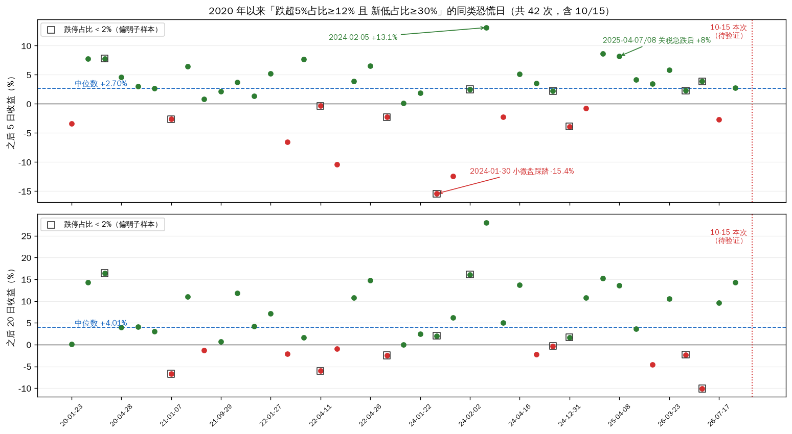

# 全市场恐慌日之后：正偏很薄、看年代、别抢第一天（全A 2005–2026）

上一轮最后发现：所有「跌超」系信号的收益，都集中在「几十只股票同一天一起恐慌」的日子——是市场恐慌本身在起作用，不是个股。这一轮把这个问题推到全市场、全历史：全部A股（含退市）自建等权指数，2005年2月至2026年10月15日，共5268个交易日。

结论三句话：正偏是真的，但很薄——恐慌日之后 5 日平均 +0.67%、20 日 +2.91%（全样本基准 +0.41% / +1.69%）；幅度由年代决定——2020 年以后 +2.03%（命中 70%），2015–2019 为负（-0.29%），股灾级联中 -1.93%；操作上最要紧的一条：别抢第一天，等一天再买平均不吃亏，真正稳定的信号是「全面反击日」而不是「跌得深」。

## 数据与口径

- 全A（沪深两市，含退市股；剔除北交所——行情表里有个别坏数据行，pre_close 是 0.01 这类值，会造出 +200400% 的假涨幅，把全市场等权均值算歪：2022-02-25 那天被抬到 +42.9%，修复后是 +1.0%）。个股单日涨跌幅截尾 ±21%，远期收益截尾 [-85%, +250%]。
- 市场收益用两个口径：等权（全市场个股日收益均值累乘）和市值加权；除特别说明，下文都用等权。
- 「恐慌日」= 当天跌超 5% 的股票占比 ≥15%（全样本 393 天，按 30 天间隔聚成 78 段独立事件）。另有更严一档 ≥25%，及「跌超 9.5%（近跌停）占比」口径。
- 之后收益：恐慌日收盘往后 1 / 5 / 10 / 20 个交易日。全样本基准（随机一天）：5 日 +0.41%、20 日 +1.69%，5 日上涨概率 56%。

## 整体：正偏很薄

| 跌超5%占比 | 天数 | 之后5日 | 之后20日 |
|---|---|---|---|
| ≥5% | 928 | +0.54% | +2.07% |
| ≥10% | 536 | +0.76% | +2.89% |
| ≥15% | 393 | +0.67% | +2.91% |
| ≥25% | 252 | +0.75% | +3.72% |
| ≥30% | 211 | +0.59% | +3.79% |

跌得越狠，后 20 日的平均修复越高（+2% → +3.8%）；但 5 日维度基本是平的（+0.5% ~ +0.8%）。「恐慌之后会反弹」在 5 日尺度上近乎没有，20 日尺度上有一点，但也就一两个百分点。

跌停潮口径更陡，也更有意思：跌超 9.5% 占比 ≥10% 的日子（100 天），后 20 日 +4.30%；但 **≥20% 的极端跌停潮（70 天）反过来了——第 1 天还在跌（-0.66%），第 5 天也没回正（-0.19%），要到 10~20 日才修复（+2.68% / +3.51%）**。极端恐慌日的正确姿势是等，不是抢。

（顺带一个对照：涨超 9.5% 占比 ≥5% 的 203 个大涨日，之后 5 日 +1.68%、20 日 +3.79%——比恐慌日还高。说明「跌得多之后会弹」有一部分只是全市场的正漂移和波动聚集，不是恐慌独有的修复机制。别过度解读。）

## 年代是主角

| 年代 | 恐慌日数 | 恐慌后5日 | 同期基准 | 恐慌后20日 | 5日命中 |
|---|---|---|---|---|---|
| 2005–2009 | 158 | +0.76% | +0.89% | +3.42% | 58% |
| 2010–2014 | 64 | +0.36% | +0.27% | +1.52% | 62% |
| 2015–2019 | 98 | **-0.29%** | +0.28% | +1.98% | 60% |
| 2020–2026 | 73 | **+2.03%** | +0.25% | +4.32% | 70% |

- 只有 2020 年以后这一段，恐慌后的正收益明显跑赢自己的基准（+2.03% vs +0.25%），命中率 70%。2005–2009 甚至微微跑输自己的基准。
- 2015–2019 全段为负，拆开更清楚：2015-06 至 2016-02 的股灾级联段，恐慌后 5 日 -1.93%、20 日 -1.97%（49 天）——级联中每次恐慌后面还有下一次恐慌。把这段拿掉，2015–2019 其余恐慌日 +1.36% / +5.92%。
- 全样本剔除级联段：5 日 +1.04%、20 日 +3.61%。

翻译一下：这个「效应」不是常数，是年代的函数。2020 年以后它像是对的；2015 年那种连续去杠杆里，抄恐慌日会一路挨打。前半段和后半段用同一套参数，是这份数据里最贵的错误。

## 实操：别抢第一天，盯反击日

- **别抢第一天**：跌停潮极值日（≥20%）次日平均还在跌（-0.66%）；把「当天收盘买」换成「次日收盘再买」，全样本恐慌日的平均 5 日收益从 +0.67% 变成 +0.78%，没有变差。如果次日先跌（151 次），当天买是 -2.46%，等一天买是 +0.85%。恐慌日之后 20 天内，有 76% 的概率能见到比当天更低的收盘价（中位最深 -4.2%）。
- **盯的不是跌幅，是反击**：恐慌之后 10 个交易日内出现「全面反击日」（涨超 9.5% 占比 ≥3%）——从反击日算，之后 5 日 +1.61%、20 日 +4.07%；分年代看，5 日收益四个年代全为正（+1.24% ~ +2.09%，其中 2010–2014 只有 9 个样本）。在试过的所有「恐慌之后怎么接」里，它是唯一跨年代都没翻车的。2020 年以来，等到反击日的恐慌，20 日中位 +6.2%；一直没等到的，只有 +1.2%。

## 当下：2026-10-15 的读数

10/15 收盘：跌超5%占比 15.1%（2020 年以来的 96 分位）、跌超9.5%占比 1.0%（89 分位）、创 20 日新低占比 **43.7%（98 分位）**——广度极宽，但跌停潮很轻。并且这是 8 个交易日内的第二次恐慌（9/28 之后）。

2020 年以来同型日（跌超5%占比 ≥12% 且 新低占比 ≥30%）含今天共 42 次：

| 切法 | 次数 | 之后5日中位 | 5日命中 | 之后20日中位 |
|---|---|---|---|---|
| 全部同类 | 42 | +2.70% | 71% | +4.01% |
| 其中：带跌停潮（≥2%） | 31 | +3.41% | 77% | +5.01% |
| 其中：不带跌停潮（今天这型） | 11 | +0.94% | 50% | -1.31% |

两个切法给出相反信号：按「有没有跌停潮」，今天落在偏弱的一半；按「是不是连续恐慌」（今天距 9/28 仅 8 个交易日），2020 年以来连续恐慌的 35 次反而更好（5 日中位 +3.47%、命中 76%，而孤立恐慌是 +2.00% / 66%）。**单日读数的切法互相打架——这本身就是「别把它当扳机」的证据。**42 次里 5 日最差 -15.4%（2024-01-30 小微盘踩踏），最好 +13.1%（2024-02-05）。

后面值得对照的只有两件事：反击日来没来（来了参照「强」的一侧）；如果始终不来、且跌停占比往 2% 以上走，就要按 2015–2016 的剧本去防，而不是按「均值修复」去等。

## 把反击日当交易做：胜率 / 频率 / 单次收益

口径同前：信号日收盘买入、等权全市场，全期 377 个信号日；纯历史统计。

- **胜率**：持 5 日 63%（2020 年以来 69%）；持 20 日 66%（70%）。扣来回成本（约 20bp）后基本不变。
- **频率**：按「一次只持一笔」执行，全期 134 笔 / 21.7 年 ≈ 6 次/年（2020 年以来约 4 次/年）。分布极不均匀：2015 年 25 次、2007 年 23 次、2008 年 19 次（三年占一半）；2011、2013、2017 年 0 次。
- **单次收益**：持 5 日中位 +2.2%、平均 +1.6%（中间一半：-2.4% ~ +6.0%）；持 20 日中位 +4.6%、平均 +4.1%（中间一半：-5.2% ~ +15.5%）。最好与最差样本（20 日 +47% / -50%）都出在 2015 年。
- **三个注意**：
  1. 等权 vs 市值加权：后者全期边际≈0（5 日 +0.23% vs 基准 +0.21%），2020 年以来 +0.68%（基准 +0.14%）——弹性主要在小票端。
  2. 去掉「前置恐慌」的普通反击日：全期类似（5 日 +1.75%），但 2020 年以来几乎无效（+0.28%，n=49）——「恐慌+反击」组合在当下更有意义。
  3. 信号在级联下跌中照发（2015-06 那批 20 日 -40% ~ -50%）：单日读数不构成扳机。

## 策略骨架：可执行参数（10-16 补充）

把上面的统计钉成一套可执行方案（等权全市场口径、不重叠执行 134 笔；均为分布统计，非保证）：

1. **触发（两步，缺一不可）**：① 恐慌日（跌超5%占比 ≥15%）；② 其后 10 个交易日内出现反击日（涨超9.5%占比 ≥3%）→ 反击日收盘执行；等不到就不动手。
2. **执行时点**：尽量抓反击日收盘；最晚次日收盘（5 日期望 +1.85% → +1.19%；2020+ +1.78% → +1.54%——打折但仍为正）。
3. **持有窗口**：5 日基础版（均值 +1.85%、中位 +2.26%、胜率 66%）；延展到 20 日平均再 +2.02%（63% 为正），代价是途中 40% 概率先见 -5%、25% 先见 -10%。
4. **中止规则**：入场后 5 日内、任一日收盘较入场跌超 -5% → 离场。条件统计：曾出现该情形的单子（25/134）最终平均 -7.92%、翻红率仅 12%——破位基本是继续走坏；2020 年以来该情形只出现过 1 次。
5. **仓位与重试**：按「最坏单笔 -10% ~ -15% 可承受」倒推单次仓位；同一波恐慌最多执行 2 次——级联里连做的代价：2015-06 连续两笔累计 -45%，2015-08~09 三笔累计 -32%。
6. **频率预期**：平均 4~6 次/年，极不均匀——有的年份 0 次（2011、2013、2017），有的年份 20 多次（2015 年 25 次、2007 年 23 次）。是「窗口」，不是常备机会。
7. **定位重申**：市场级 beta 的「动手开关」，不选股、不替代持有。单独运行（只在这些窗口持仓、每笔扣 0.2% 成本）：全期 134 笔累计 6.3x，同期等权买入持有约 23x——价值在纪律与时机，不在收益率本身。

**10-16 回测更新**（组合级，详见 `strategy-backtest-2026-10-16.md`）：① 进场时点收紧为「尽量抢信号日收盘」——次日进场复利口径 6.27x→2.53x；② 「同波≤2次」未通过回测，不建议采用；③ -5% 止损把回撤 -42%→-18%~-29%、最差单笔 -32%→-10% 左右（吃执行速度：拖一天≈无效；触价/滑点假设仍会改变细节）。

## 边界

- 这不是策略。把「恐慌日买、持 5 天」做成机械策略（扣 0.1% 成本），全期（市值加权）累计 +216%，一直持有是 +386%——低暴露版本，不是收益引擎。它适合回答「市场在什么状态」，不适合回答「今天买什么」。
- 事件高度重叠：393 个恐慌日只构成 78 段独立事件，按段聚合后平均 5 日 +0.57%、t≈1.9，只是弱显著。所有数字当参考分布，不当定理。
- 事件数字未扣成本；样本含退市股（避免幸存者偏差）、不含北交所；库内数据自 2005 年初起。
- 结论与上一轮一致：恐慌结构是 beta，不是 alpha。

---
Data as of: 2026-10-15
Generated: 2026-10-16
