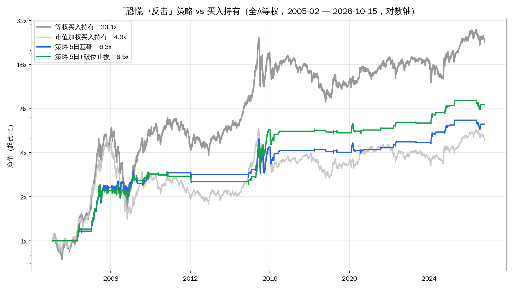
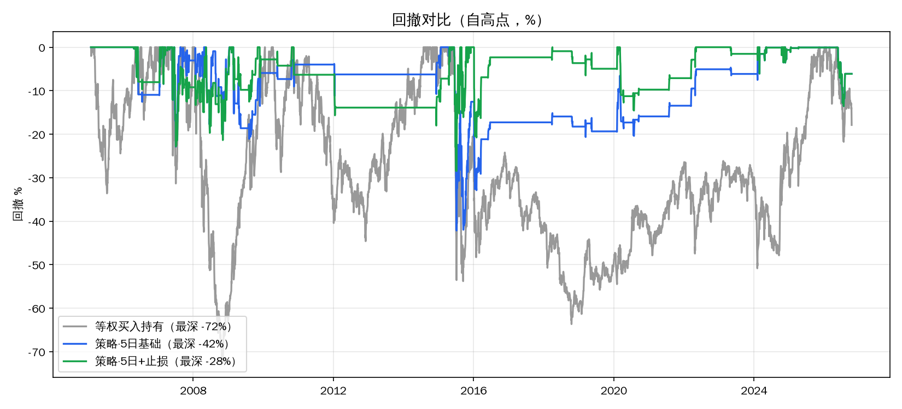
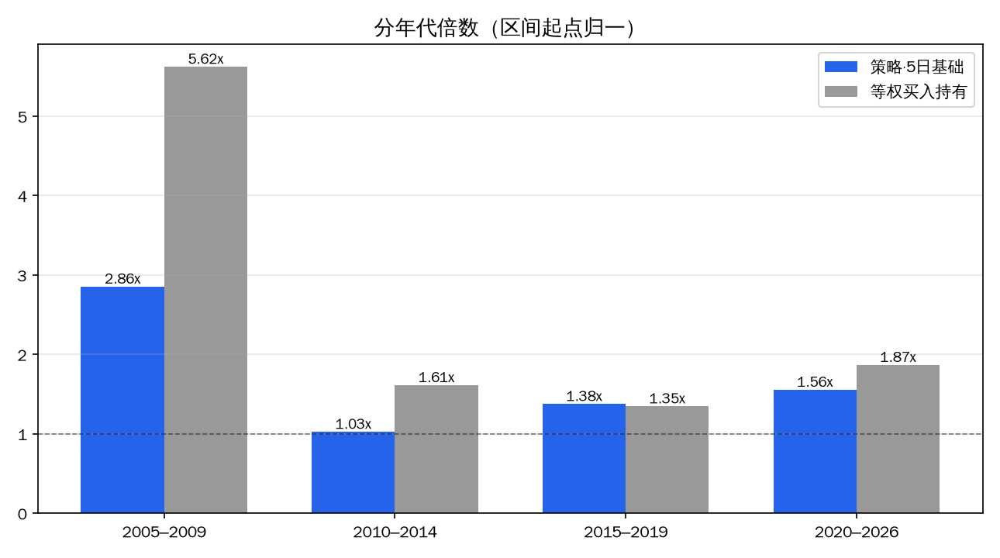

# 「恐慌→反击」策略独立回测：执行速度是生命线（全A 2005–2026）

底稿：《全市场恐慌日之后：正偏很薄、看年代、别抢第一天》（`post-washout-2026-10-16.md`）。本篇把「恐慌→反击日」信号做成一条完整的资金曲线：含成本、单账户轮动、不重叠，并测三个执行口径的敏感度。

结论三句话：**信号有效但很薄**——134 笔、胜率 66%、单笔净 +1.65%，净值 6.3 倍（年化 8.8%）、最大回撤 -42%、在场时间仅 12.7%；**它不是收益引擎**——同期等权持有 23.1 倍（年化 15.6%），四个年代里三段明显跑输；**成败在执行的最后一公里**——进场晚一天净值砍到 2.5 倍；-5% 止损能把回撤压到 -18%~-29%（视成交速度），但拖一天执行约等于没用。

## 方法与口径

- **信号**：恐慌日（跌超5%占比 ≥15%）后 10 个交易日内出现反击日（涨超9.5%占比 ≥3%）→ **反击日收盘买入**。
- **执行**：单账户、不重叠（持仓期间忽略新信号，结束后可再接）；持有 5 个交易日；单边成本 0.1%（来回 0.2%）；空仓期收益计 0。
- **标的**：全A等权自建指数（含退市、剔北交所、涨跌幅截尾 ±21%，同底稿）。市值加权版本作对照。
- 样本：2005-02-01 至 2026-10-15，共 5268 个交易日（21.7 年）。
- 复现：`scripts/bt1.py`（主回测）、`scripts/bt1b.py`（诊断）、`scripts/bt2.py`（图表）；净值序列 `data/bt1_equity.csv`。

## 主结果（基准口径：5 日持有）

- **134 笔 / 21.7 年**（实际分布 0~25 笔/年），胜率 66%，单笔净 +1.65%（中位 +2.05%）。
- **净值 6.27x**（年化 8.8%），**最大回撤 -42.2%**（区间全部落在 2015-06-12 → 2015-07-09），在场时间 12.7%。
- 对照：等权买入持有 **23.07x**（年化 15.6%、回撤 -72.3%）；市值加权买入持有 4.87x（7.6%、-72.0%）。

| 变体 | 笔数 | 胜率 | 单笔净均值 | 净值 | 年化 | 最大回撤 |
|---|---|---|---|---|---|---|
| 基准·5日 | 134 | 66% | +1.65% | **6.27x** | 8.8% | -42.2% |
| 次日进场（t+1 收盘） | 134 | 60% | +0.99% | 2.53x | 4.4% | -61.8% |
| 「同波≤2次」连续段版 | 99 | 68% | +1.41% | 3.18x | 5.5% | -46.9% |
| 「同波≤2次」30日聚簇版 | 36 | — | — | 2.24x | 3.8% | -8.4% |
| 20 日持有 | 67 | 63% | +3.26% | 3.93x | 6.5% | -73.9% |
| 20 日持有 + 止损 | 80 | 52% | +3.71% | 10.30x | 11.3% | -48.7% |
| 成本翻倍（0.2%/边） | 134 | 65% | +1.45% | 4.79x | 7.5% | -43.1% |
| 市值加权版·5日 | 134 | 54% | +0.27% | 1.19x | 0.8% | -44.0% |

## 三个执行发现（本次回测的主要增量）

**① 进场速度是生命线。** 单笔口径只差约 0.7 个百分点（+1.85% → +1.19%，毛），但复利到 21.7 年：6.27x → **2.53x**；且回撤恶化到 -61.8%。要抢就抢信号日收盘。

**② 止损有效，但结论吃成交假设——报区间。** -5% 破位止损的四个口径：

| 止损成交假设 | 笔数 | 净值 | 最大回撤 | 最差单笔 |
|---|---|---|---|---|
| 无止损 | 134 | 6.27x | -42.2% | -32.5% |
| 破位后次日收盘成交 | 139 | 5.99x | -40.7% | -20.4% |
| 破位当日收盘成交 | 143 | 8.52x | -28.5% | -11.3% |
| 盘中触 -5% 即成交 | 143 | 15.00x | -18.2% | -10.0% |

共 22~23 次止损触发。它把最差单笔从 -32.5% 压到 -10% 左右、回撤腰斩甚至更多——但前提是**执行快**：拖到次日再走约等于没做。

**③「同波≤2次」上限未通过。** 骨架里曾建议「同一波恐慌最多执行 2 次」（防级联连做，2015-06 连做两笔累计 -45%）——回测否掉了它：连续段版纯变差（3.18x、回撤反而 -46.9%）；30 日聚簇版回撤极低（-8.4%）但收益只剩 2.24x。它是「降参与」旋钮，不是免费的风控——**不建议采用**，风控交给止损。

## 分年代（基准口径，区间起点归一）

| 年代 | 策略倍数 | 等权持有倍数 |
|---|---|---|
| 2005–2009 | 2.86x | 5.62x |
| 2010–2014 | 1.03x | 1.61x |
| 2015–2019 | 1.38x | 1.35x |
| 2020–2026 | 1.56x | 1.87x |

四段里只有 2015–2019 与持有打平（且靠 2015 级联行情的巨大波动），其余三段跑输。2020 以来 30 笔、净值 1.56x、段内回撤 -14.8%。

## 分年记录（基准口径）

| 年 | 笔数 | 胜率 | 年度倍数 |
|---|---|---|---|
| 2006 | 6 | 50% | 1.165 |
| 2007 | 23 | 83% | 1.991 |
| 2008 | 19 | 47% | 1.044 |
| 2009 | 14 | 71% | 1.180 |
| 2010 | 3 | 33% | 1.021 |
| 2012 | 1 | 0% | 0.976 |
| 2014 | 1 | 100% | 1.029 |
| 2015 | 25 | 72% | 1.492 |
| 2016 | 8 | 62% | 0.946 |
| 2018 | 2 | 50% | 0.988 |
| 2019 | 2 | 50% | 0.987 |
| 2020 | 8 | 62% | 1.043 |
| 2021 | 1 | 100% | 1.029 |
| 2022 | 2 | 100% | 1.097 |
| 2023 | 1 | 0% | 0.989 |
| 2024 | 9 | 78% | 1.305 |
| 2025 | 2 | 100% | 1.090 |
| 2026 | 7 | 43% | 0.939 |

（2011、2013、2017 年为 0 笔。）

## 图表

## 结论与用法

- 定位重申：它是**「什么时候动手」的纪律层**，不是收益引擎，也不选股。独立运行只适合一小块专门资金（低暴露 12.7%）；更大的用途是给「加仓/出手」定节奏。
- 若要执行，三条规则：**抢信号日收盘**；**-5% 止损挂在场内（触价成交）**；**不加「同波≤2次」上限**。
- 单笔仓位按「最坏 -10%~-15% 可承受」倒推；注意样本 134 笔、极端值由 2015 主导。

## 边界

- 全A等权指数不可直接交易；市值加权口径 1.19x（≈无边际）——弹性仍在等权/中小票端。
- 未计税费/冲击/滑点等实操折损（成本敏感性：0.2%→0.4% 时 6.27x→4.79x）。
- 止损的「盘中触价」在日频数据下不可观测，故给区间；「当日收盘成交」亦略偏乐观（收盘后无法按收盘价交易，取近似）。
- 空仓期收益计 0（未计货基/逆回购增强）；单账户全仓轮动为理想化设定。
- 与一切历史回测相同：不保证未来。

---
Data as of: 2026-10-15
Generated: 2026-10-16
