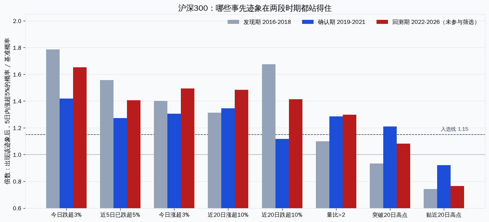
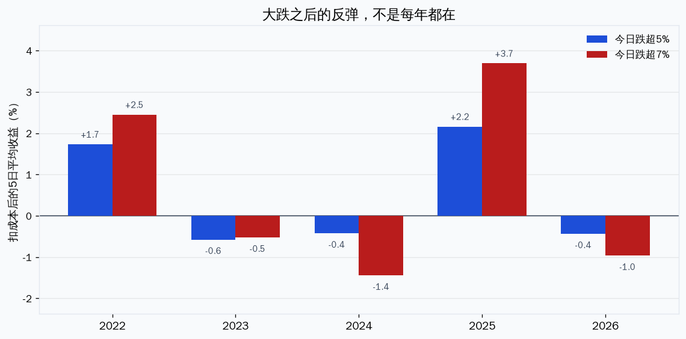

# 5日内涨5%：迹象能重复，交易不赚钱

先锁定「收盘看见迹象、次日开盘买、持有5个交易日、这笔收益至少5%」。在沪深300里倒查事先迹象。17个迹象事先写死，不看着结果加。发现期2016–2018，确认期2019–2021，只有两段都过线的才拿去2022至2026-10-14回测。

四条过了线。它们都能提高「5日内再涨5%」的概率，回测期也还在。但这些交易的平均收益只有0到0.3%，扣掉来回20个基点的成本之后，基本上是零。概率上的迹象，没有变成能赚钱的策略。

## 病例怎么定的

池子是沪深300当时的成分，不是事后留下的名单。迹象只用当天收盘已经知道的价格和成交量。买入是下一个交易日的开盘，卖出是再过5个交易日的开盘。开盘封在涨停上的，不算能成交的病例。停牌把持有期拉过15个自然日的，也剔除。

过线标准事先定死：两段时期各自至少500次，出现该迹象后的概率至少是基准的1.15倍，而且绝对高出至少2个百分点。方向必须一致。回测期的数字不参与挑选。

基准概率本身不低。发现期10.5%，确认期15.8%，回测期12.2%。沪深300里，5个交易日涨5%是常事，不是稀有信号。

## 站住的四条

| 迹象 | 发现期倍数 | 确认期倍数 | 回测期倍数 | 回测期概率 | 回测期平均收益 |
|---|---|---|---|---|---|
| 今日跌超3% | 1.79 | 1.42 | 1.65 | 20.2%（基准12.2%） | +0.32% |
| 近5日已跌超5% | 1.56 | 1.27 | 1.41 | 17.1% | +0.24% |
| 今日涨超3% | 1.40 | 1.31 | 1.49 | 18.2% | +0.12% |
| 近20日涨超10% | 1.31 | 1.34 | 1.48 | 18.1% | +0.10% |

回测期基准的5日平均收益只有+0.03%。所以这四条相对基准都有一点点正的平均收益。扣掉买卖各10个基点之后：

- 今日跌超3%：重叠计算还剩+0.12%；同一只股票7天内不重复计，剩+0.01%。
- 近5日已跌超5%：重叠+0.04%，不重复计是-0.01%。
- 今日涨超3%、近20日涨超10%：扣完成本是负的。

「更常出现5%上涨」和「平均能赚钱」不是一回事。跌了3%之后，接下来5天冲过5%的次数确实更多，但没冲过的那几次亏得也不小，平均值被拉回零附近。

## 没过线的，不能因为回测期好看就捡回来

近20日跌超10%，发现期倍数1.67，是17条里最强的。确认期掉到1.12，绝对优势1.8个百分点，没过2个百分点那条线，所以排除。回测期它又回到1.41，平均收益+0.32%。如果看着回测期把这条捡回来，就是在用考试卷改答案。

量比大于2、突破20日高点，确认期看起来过线，发现期不过。贴近20日高点则是反的，三段时期倍数都低于1（0.74、0.92、0.76）。已经贴着高点的，接下来5天再涨5%的概率更低，不是更高。这条是否定迹象，同样没有做成交易。

## 边界

- 迹象清单是事先写的17条，不是把所有可能的组合搜到好看为止。组合没测。
- 同一次上涨会落在连续多天的样本里，次数被放大。不重复计之后，仅剩的那点收益也没了。
- 成本按来回20个基点。没有算冲击成本和买不到的滑点。算上会更差。
- 这是沪深300。小盘里5%更常见，迹象会不一样，不能外推。
- 代码在 `scripts/case_control.py`。行情是本地 `stock_daily` 加复权因子，成分用当时的沪深300名单。数据截至2026-10-14。

## 又试了26条

门槛没有放低。新的26条同样要过发现期和确认期，并且确认期拆成2019–2020和2021两段，两段倍数都要高于1.10。回测期仍然最后才打开。

26条里14条概率过线。扣完成本、同一只股票不重复计之后，平均收益还为正的有5条。其中3条只有+0.07%到+0.09%，当噪声。剩下两条是同一件事的更极端版本：今日跌超5%、今日跌超7%。不重复计、扣成本后，5日平均收益分别是+0.39%和+0.49%。

这不是新因子。第一轮的「今日跌超3%」扣完成本已经接近零，把跌幅门槛加严，平均值被少数大反弹抬高了。2023、2024、2026这三年扣完成本是负的。跌超7%拿掉2025年，平均收益回到-0.02%。信号也稀：跌超7%只占回测期可交易样本的0.7%，做不成一个常在场内的组合。

多试一次，提高的是碰上偶然过线的机会，不是找到稳定因子的机会。这次没有碰到。

---
Data as of: 2026-10-14
Generated: 2026-10-16
