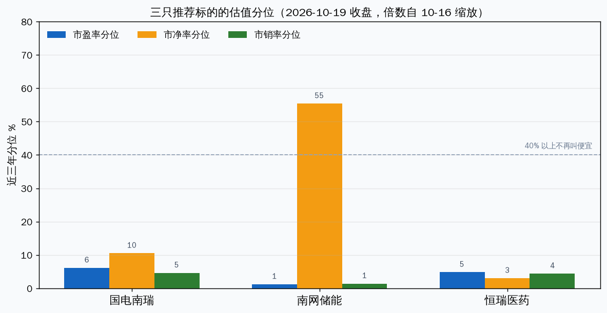

# 三只还在合理成本上的公司

推荐的不是“行业有空间”的全部名字，是上一问里成本还站得住的三只：国电南瑞、南网储能、恒瑞医药。半导体设备四家市销率分位仍在 81%–87%，不在这份名单里。荣昌、百利的低市盈率来自授权进账，也不在。

合理的定义：近三年分位不在贵的一端，而且便宜不是一笔授权把利润或营收撑出来的。今天涨跌不算。倍数取 2026-10-16 的 daily_basic，按 10-19 收盘价缩放。分位样本约 725 个交易日，自 2023-10-19。

| 代码 | 名称 | 10-19 收盘 | 市盈率 | 分位 | 市净率 | 分位 | 市销率 | 分位 | 一个月 | 三个月 |
|---|---|---|---|---|---|---|---|---|---|---|
| 600406 | 国电南瑞 | 22.99 | 22.0 | 6% | 3.55 | 10% | 2.65 | 5% | +4.3% | +3.6% |
| 600995 | 南网储能 | 11.45 | 18.6 | 1% | 1.56 | 55% | 4.46 | 1% | -7.1% | -3.2% |
| 600276 | 恒瑞医药 | 46.08 | 39.6 | 5% | 4.74 | 3% | 9.76 | 4% | +4.9% | -13.4% |

南网储能市净率分位 55% 是这张图里唯一越过 40% 的柱。盈利倍数低，是因为利润涨得比股价快，不是资产便宜。

---

## 国电南瑞（600406.SH）

**电网自动化设备 / 电力调度与继保 / 上证主板 / 沪深 300（2026-09-30 成分）**

卖的是电网调度、继电保护和变电站自动化，不是储能电芯。国家电网体系内的设备供应商，转换成本在已投运的调度和保护系统里，不在品牌故事里。

2026 上半年营收 277.7 亿，同比 +14.5%；归母 30.7 亿，同比 +4.1%。毛利率 25.3%，比去年同期 26.5% 低约 1 个点。全年 2025 年营收 662 亿、归母 82.8 亿，经营现金流 128 亿，现金流 / 净利润 1.54。上半年这条坏了：经营现金流只有 5.9 亿，对净利润 0.19 倍；去年上半年是 28.1 亿、0.95 倍。一季度现金流为负在这个行业常见，但上半年仍比去年差一个数量级，要等四季回款才能说利润是真的。资产负债率 40%。

估值三把尺子都在近三年底部附近。近一个月、近三个月价格是涨的，便宜不是这一周砸出来的。利润增速只有 4%，低于营收增速，便宜里有一部分是盈利质量还没跟上规模。

风险：上半年现金流不能在四季回到 1 倍附近；电网投资招标价继续压毛利率到 24% 以下；把它当成储能运营商去买，业务对不上。

## 南网储能（600995.SH）

**电网侧储能运营 / 抽蓄与新型储能资产 / 上证主板 / 中证 500，不在沪深 300（2026-09-30）**

南方电网旗下的储能运营平台。收入来自电站运营，不是卖电芯。这是三只里和“电网侧调节”最贴的一只。抽蓄和电化学的收入拆分这次没有从分部表里重拉，下面不报占比。

2026 上半年营收 41.2 亿，同比 +24.8%；归母 11.1 亿，同比 +33.6%。毛利率 52%，净利率 32%，负债率 54%。经营现金流 22.9 亿，是净利润的 2.1 倍，利润不是做出来的。但购建固定资产花了 47.8 亿，自由现金流为负约 25 亿。2025 年全年同样：经营现金流 46 亿，资本开支 86 亿。便宜的市盈率，买的是还在往里砸钱的资产，不是已经躺平收租的现金。

所以市盈率分位 1%、市销率分位 1%，市净率分位仍有 55%。利润上来了，净资产没有跟着变便宜。近一个月价格 -7.1%，近三个月 -3.2%，和南瑞的上涨不是同一条线。这次没有检索到能单独解释这 7% 的公司公告，不编原因。

风险：容量电价和现货收益不能覆盖资本开支，自由现金流继续为负；电芯价格战不直接打它的售价，但会通过新项目回报率倒逼它少投；若只看 18 倍市盈率就当成深度便宜，会忽略市净率还在中位。

## 恒瑞医药（600276.SH）

**创新药 / 肿瘤、麻醉、造影等 / 上证主板 / 沪深 300（2026-09-30 成分）**

国内创新药里利润已经做成常规生意的那一只，不是靠一笔海外授权撑报表的生物科技。毛利率 86%，负债率 8%，资产负债表干净。

2026 上半年营收 154.6 亿，同比 -1.9%；归母 44.7 亿，同比 +0.3%。增长停了。经营现金流 19.9 亿，对净利润 0.44 倍；去年上半年是 43.0 亿、0.97 倍。2025 年全年经营现金流 112 亿，对净利润 1.46，全年质量是好的，这一半年变差了。市盈率 40 倍、市销率 9.8 倍、市净率 4.7，三个分位都在 3%–5%。低分位是价格下来了：近三个月 -13.4%，近一个月 +4.9%，跌完之后横住。市销率 9.8 倍相对制造业仍然贵，合理只成立于相对恒瑞自己的三年。

和荣昌分开。荣昌 2026 上半年利润 46.6 亿、去年同期还在亏，市盈率 9 倍是授权进账，不在推荐里。百济市盈率仍有 89 倍，绝对成本不合理。

风险：营收同比转正之前，40 倍只是“不便宜到贵”，不是成长股的买点；上半年现金流若全年维持在 0.5 倍以下，分位低也不能当质量确认；创新药支付和集采若打到核心品种，毛利率 86% 会先于估值分位坏掉。

---

## 放在一起

三只都不是“行业还有空间，所以现在该买”。南瑞是设备商，增长还在，现金流这个半年差。储能是运营商，利润和现金流都干净，自由现金流为负，资产不便宜。恒瑞是创新药里报表最像正常公司的，增长停了，估值回到自己的历史低位。

若只留一只当作“优秀公司、成本还合理”的对照样本，是国电南瑞：三把尺子都低，收入还在长，便宜不是授权造的。它的未完成项是上半年回款。南网储能适合看成受监管的资产，不适合看成高增长。恒瑞要等营收重新转正，才配得上“用低分位持有优秀公司”这句话。

这三只都不在当前持仓里。上面不是下单清单。

## 验证锚点

- 价格：南瑞 22.99、储能 11.45、恒瑞 46.08，均为 2026-10-19 收盘。
- 时间：2026 年三季报（10 月下旬至 10 月底窗口）看南瑞、恒瑞的经营现金流是否回到去年同期附近；储能看资本开支是否仍高于经营现金流。
- 数据：南瑞上半年经营现金流 5.9 亿对净利润 30.7 亿；储能购建 47.8 亿对经营现金流 22.9 亿；恒瑞上半年营收同比 -1.9%。

---

Data as of: 2026-10-19 收盘；财务为 2026 年中报及 2025 年报
Generated: 2026-10-19
