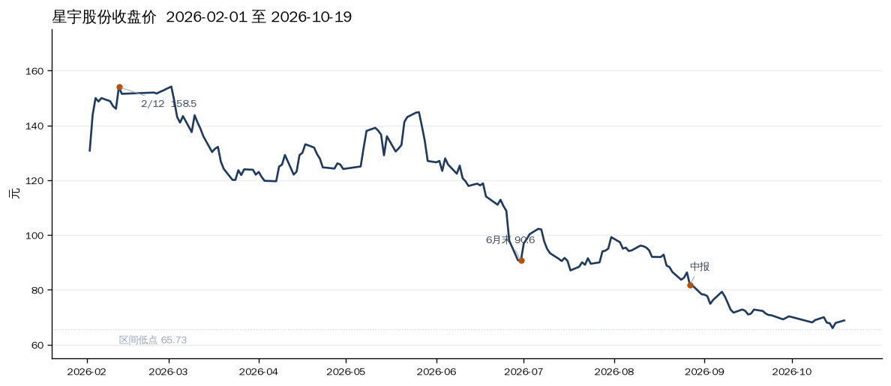

# 星宇股份：现在不是买点

**星宇股份（601799.SH）— 汽车车灯 / 汽车零部件 / 沪市主板。** 指数成分这次没核到，不写。

现在不是好的买入点。3 年 P/S 分位 0.8%，价格也在 3 年区间的 0.9%，看起来很便宜。便宜的原因是增长停了，不是市场还没给正在爆发的业绩定价。三季报预约 10 月 29 日，出来之前不建仓。

午休价 as-of 2026-10-20 11:30：69.16，相对昨收 68.82 为 +0.49%。下面估值用 10 月 19 日收盘。

---

## 「好的买入点」拆开看

| 代理 | 读数 | 是否支持现在买 |
|---|---|---|
| 3 年 P/S 分位 | 1.278，0.8%（741 个交易日；P20 / 中位 / P80 = 2.40 / 2.88 / 3.68） | 便宜，但是结果不是理由 |
| 前复权价格位置 | 0.9% 分位，较高点回撤 -54.9% | 跌得多，不等于到底 |
| 增长 | 2026 上半年营收 +1.9%，归母 -5.3%；二季度单季归母约 -18% | 不支持。不是业绩爆发里的低估 |
| 现金流 | 上半年经营现金流 9.91 亿 / 归母 6.69 亿 = 1.48 | 利润没有靠储备释放，质量不是卖点 |
| 三季报 | 预约 2026-10-29，实际披露日仍空 | 验证还没到 |

## 增长是怎么停的

累计口径，单位亿元。

| 期 | 营收 | 营收同比 | 归母 | 归母同比 | 毛利率 |
|---|---|---|---|---|---|
| 2025 全年 | 152.57 | +15.1% | 16.24 | +15.3% | 19.65% |
| 2026 一季 | 34.30 | +10.8% | 3.55 | +10.3% | 19.33% |
| 2026 上半年 | 68.84 | +1.9% | 6.69 | -5.3% | 18.76% |

二季度单季 = 上半年减一季度：营收 34.54 亿，去年二季度 36.62 亿，约 -5.7%；归母 3.14 亿，去年 3.84 亿，约 -18%。毛利率从上半年同期的 19.27% 降到 18.76%。减速发生在二季度，不是一季度已经看见的。

资产负债率 39%。经营现金流覆盖净利润，不按利润平滑去读。

## 近期趋势

2026-02-12 高点 158.50，10 月 19 日收 68.82。前复权回撤 -54.9%。近 20 个交易日（9/14 的 72.81 到 10/19）-5.5%，近 60 个交易日（7/20 的 88.42 到 10/19）-22.2%。今天上午低点 67.92，仍高于这段的低点 65.73。

主跌段在 2 月到 6 月：月末收盘从 2 月的 152.61 落到 6 月的 90.62。中报 8 月 27 日披露时，股价已经在 78 附近。8–9 月的解约报道解释的是后一段，解释不了从 158 到 90 的那一截。

原因只写核过的和标明出处的：

- 业绩减速是公司自己的数。上半年营收几乎不增长，二季度利润同比转负。公司过往口径是九成以上收入来自新车配套，新车产量是订单的上游。乘联分会「2026 年上半年国内汽车生产同比 -4%」来自媒体转述，这次没核到乘联原文。
- 8 月下旬到 9 月中旬，多家媒体报道校招生解约、赴港上市申请仍在审、客户可能复核供应商。这次没核到公司公告确认核心客户砍单，也不把「订单取消」写成事实。回购「进展为零」同样是媒体说法，未核公告。
- 3 月卖方曾按 2026 年归母约 20 亿给目标价，当时股价 126.79。上半年只有 6.69 亿，且二季度在掉。那份预测不作本次判断的分母。

同业只作位置参照，样本 4 家，统计仅供参考。10 月 19 日收盘：星宇 PE 12.4 / PS 1.28；科博达 20.8 / 2.19；德赛西威 17.9 / 1.35；华域汽车 7.1 / 0.27。华域是整车配套平台，不是车灯同业，PE 更低不说明星宇贵。车灯和汽车电子这组里，星宇是最便宜的，便宜对应的是增速掉下来。

## 为什么现在不买

两条机会路径都不成立。

业绩爆发加低估值：先要增长已经起来。这里增长是停的，二季度比一季度更差。P/S 0.8% 分位是市场已经按「没有增长」在定价，不是没定价。

困境反转：车灯龙头、模具和车型生命周期带来的转换成本，这些还在。反转要看见量或毛利率重新向上。三季报还没出，反转没有证据。

持仓表里没有星宇。记录现金 1746 元停在 9 月 11 日，买 1 手约 6916 元都不够。组合股票市值约 29 万，8% 是 2.32 万，大约 300 股。那是上限，不是今天的数量。不要用比亚迪、宁德、芭田的破位仓给这笔筹资。

## 允许买的条件

10 月 29 日三季报之后，同时满足才买第一笔 100 股，约 6900 元，不是 300 股：

- 前三季度营收同比回到 8% 以上。上半年只有 +1.9%，回到 8% 才说明二季度的停顿没有延续。
- 毛利率不低于 18.8%。上半年 18.76%，再下一档就不买。
- 公告里没有已确认的核心客户砍单。

任一不满足，不建仓。价格再探 65.73 也不是单独的买入触发。

若买了这 100 股，认错不看某一天的涨跌。下一份完整财报若前三季度或全年归母同比仍差于上半年的 -5.3%，这 100 股离场，不往下摊。

---

Data as of: 2026-10-20 11:30 价；估值与财务截至 2026-10-19 收盘及已披露中报
Generated: 2026-10-20
