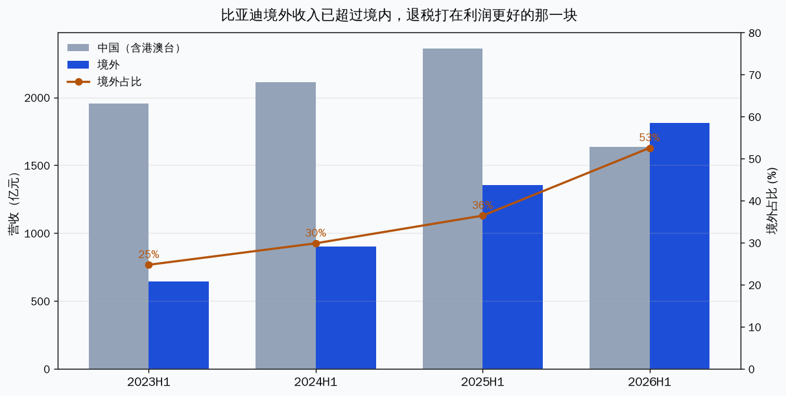
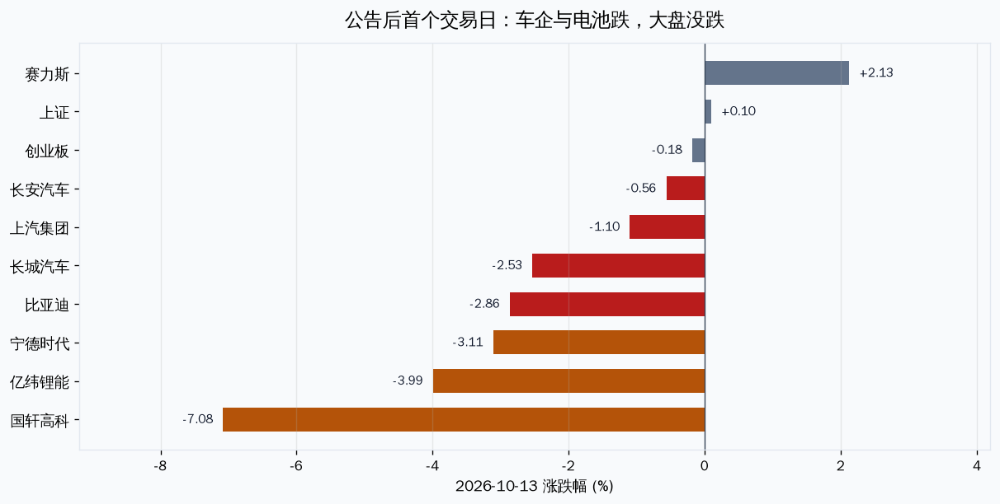
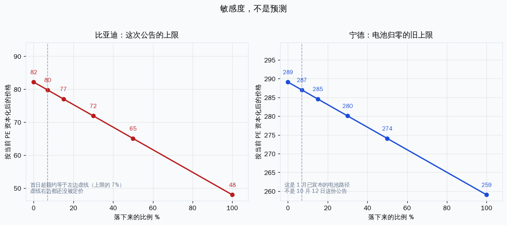

# 出口退税调整对持仓的影响与估值

先说结论。10 月 12 日的调整直接打的是比亚迪，不是整个持仓。比亚迪占组合 58.7%，10 月 13 日收盘 82.18，当天跑输上证约 3 个百分点。P/S 3 年分位 6.4% 是便宜，但 PE 月度分位 70% 不便宜——便宜的是收入，不是利润。退税下调打的正是利润。这不是加仓信号。

宁德时代当天也跌了 3.1%，但这次公告改的是整车退税率，不是电池。电池退税取消是 1 月已经宣布、2027 年 1 月 1 日生效的旧日程。其余五只没有直接敞口。

---

## 核实：这次调整是什么

「近期出口退税调整」对应的是 2026 年 10 月 12 日财政部、税务总局公告 2026 年第 29 号，不是 1 月那次光伏/电池调整。

| 条款 | 内容 | 生效 |
|---|---|---|
| 新能源汽车增值税出口退税率 | 13% 下调至 9% | 2027-04-01，以报关单出口日期为准 |
| 电子烟设备装置 | 取消增值税出口退税 | 同日 |
| 消费税 | 不调整 | — |

来源：新华社 2026-10-12 17:42、人民网转载、中新社、界面/新浪对公告原文的引述。21 世纪经济报道称清单覆盖 67 类新能源车，含纯电商用车和插混（含增程）乘用车。过渡期约 5.5 个月。

相关但不是这次新信息的旧政策（财政部税务总局公告 2026 年第 2 号，2026-01-09）：2026-04-01 起取消光伏等产品退税；电池退税率 9% 降至 6%，2027-01-01 起取消。持仓里没有光伏组件。金风科技是风电整机，不在那份清单里。

电子烟与持仓无关。

---

## 谁被打到

持仓股数来自 hold-status（价格日期停在 2026-09-11，股数沿用，价格全部换成 2026-10-13 收盘）。今天 10 月 14 日 07:36 盘前，行情尚未开盘。现金 1,746 元是表内推算，可能过期。组合合计约 29.4 万元。

| 标的 | 市值 | 占比 | 与这次公告的关系 |
|---|---|---|---|
| 比亚迪 2100 股 @ 82.18 | 17.3 万 | **58.7%** | 直接。整车出口退税率 -4 个百分点 |
| 宁德时代 100 股 @ 289.10 | 2.9 万 | 9.8% | 间接。电池退税取消是旧日程，2027-01-01 |
| 芭田股份 | 2.7 万 | 9.3% | 无 |
| 科创芯片 ETF | 2.6 万 | 9.0% | 无 |
| 招商银行 | 2.1 万 | 7.3% | 无 |
| 金风科技 | 1.0 万 | 3.2% | 无。不是光伏 |
| 兴业银锡 | 0.6 万 | 2.1% | 无 |
| 现金 | 0.2 万 | 0.6% | — |

比亚迪加宁德占 68.5%。这次政策对组合的意义，几乎等于它对比亚迪的意义。

---

## 比亚迪：成本怎么算，算到哪一步停

机制：出口货物免征增值税，进项按退税率退。退税率从 13% 降到 9%，差额 4 个百分点做进项转出，计入成本。基数是报关离岸价（FOB），不是海外终端售价，也不是财报里的「境外收入」。

2026 半年报地区拆分（TuShare fina_mainbz，2026-06-30）：

| | 营收 | 毛利 | 毛利率 |
|---|---|---|---|
| 境外 | 1,812.7 亿 | 393.6 亿 | **21.7%** |
| 中国（含港澳台） | 1,635.5 亿 | 256.3 亿 | 15.7% |
| 合计 | 3,448.2 亿 | 649.9 亿 | 18.8% |

境外收入占比 52.6%，半年报披露口径同比 +33.9%。汽车业务毛利率 22.3%，电子及其他 5.0%。境外毛利率 21.7% 贴近汽车、远离电子，所以境外收入的大头是车，不是电子代工。

上限（不是预测）：把境外收入全部当成可退税的中国出口 FOB，且一点不能转嫁。

- 半年境外收入年化 3,625 亿 × 4% = **145 亿税前**
- 半年报有效税率 15.6%（所得税 22.8 亿 / 利润总额 146.1 亿）→ 税后约 **122 亿**
- 对比半年报归母 123.3 亿的年化 247 亿，上限相当于利润的一半
- 2027 年只影响 4 月以后的 9 个月，上限约 **92 亿税后**

这个上限偏高，缺三块我没有一手数、所以不往下编：

1. FOB 低于财报境外收入。境外收入含运费、本地渠道和终端价差。长江证券说若海外售价是国内 2 倍，4 个百分点反映到出口车毛利率不到 2 个点——这是卖方假设，我没有 FOB，不采用。
2. 海外工厂产量不享受中国出口退税。8 月产销快报里出口 189,466 辆、海外销售 188,746 辆，几乎重合，说明截至 8 月本地化还没替代出口大头。到 2027 年 4 月只剩不到 6 个月，替代不了大部分。9 月快报这次没重新核对，这是缺口。
3. 转嫁。境外毛利率 21.7%，4 个点大约吃掉境外毛利的两成，如果完全不能涨价。低价走量车空间小，中高端有空间。转嫁率现在不可观测。

所以能说的是：机械成本不小，而且打在毛利更好的海外那一块；实际利润影响落在「上限的一个折扣」里，折扣取决于涨价和本地化，现在两头都没数据。

时间结构比幅度更清楚。报关日在 2027-04-01 之前仍按 13%。到那天之前有抢出口的激励，量可能前移，成本后置。三季报（库里的披露日是 10 月 31 日，尚未发布，下面不用未发布数字）不可能体现这笔成本。第一份能看见它的财报是 2027 年二季报。

---

## 宁德时代：这次公告不是主冲击

半年报境外收入 871.3 亿，占 31.5%，毛利率 30.0%，高于境内 21.2%。归母净利 432.8 亿。

10 月 12 日公告不改电池退税率。电池路径是 1 月旧公告：现在已经是 6%（4 月 1 日起），2027 年 1 月 1 日归零。若把境外收入全部当成中国出口电池、且不能转嫁，6 个百分点的年化税前成本约 105 亿，税后约 88 亿，相对年化净利大约一成。比比亚迪的上限小，但生效更近，而且市场从 1 月起就知道。

这次新信息对宁德的传导是间接的：整车厂出口成本上升之后，可能压电池价格，或在 2027 年 4 月后放慢出口。这一条没有公司披露可以量化，不估一个数。

---

## 10 月 13 日市场怎么定价

公告在 10 月 12 日 17:42，收盘之后。13 日是第一个交易日。

比亚迪 -2.86%，上证 +0.10%，超额约 -3 个点。长城 -2.53%（也有出口），长安 -0.56%，上汽 -1.10%，赛力斯 +2.13%（出口依赖低得多）。电池股跌得更多：宁德 -3.11%（创业板 -0.18%），亿纬 -3.99%，国轩 -7.08%。国轩 9 月底到 10 月 8 日刚连涨，-7% 不能全部记到这份公告上。

一天跌 3 个点，消化不了「上限相当于一半利润」这种情形，也说明市场没有按上限定价。更接近「知道有成本、但还有半年、且头部能转嫁一部分」。

---

## 近期趋势

比亚迪：9 月 7 日以来 20 个交易日 -5.0%，7 月 13 日以来 60 日 -5.5%，上证同期 -3.4% / -2.9%。7 月以来区间高点 96.20、低点 80.66，现价 82.18，贴着区间下沿。10 月 12 日收盘 84.60，已经在止损价 86 下面；13 日的公告跌是在破线之后又走了一步，不是破线的原因。

原因能对上的有三层。8 月 31 日半年报落地（营收 -7.1%、归母 -20.5%，Q2 低于当时的机构共识）是自身的。国内份额仍弱、增长靠出口，是结构性的，8 月快报出口占比约 43%、国内估算仍是两位数下滑。10 月 13 日这一天的超额下跌，时间上对齐公告，板块没跌，算外生政策的第一脚。没有检索到比亚迪专属的另一条催化。

趋势状态：缓跌，贴着三个月低点，不是崩。

宁德时代：20 日 -17.0%，60 日 -19.5%。创业板同期 -13.0% / -20.5%。60 日跌幅大体是板块，20 日比创业板再差 4 个点。区间高点 405.20、低点 286.75，现价 289.10，就在低点上。10 月 13 日超额约 -2.9 个点，和公告同日，但是电池股集体的，不是宁德独有。

趋势状态：下行，位置在区间底部。便宜和趋势向下同时成立。

对结论的修正：P/S 或 PE 分位低，不能覆盖「下行还没走完 + 一笔 2027 年才入账的成本还没定价完」。不摊平。

---

## 估值

尺子按行业换。比亚迪、宁德的 P/S 是 3 年日频（740 个观测，2026-10-13）。PE、银行 PB 是 3 年月度采样（37 个点，比日频粗，每个点大约 2.7 个分位），单独标明。

| 标的 | 现价 | 主尺 | 读数 | 另一把尺子 |
|---|---|---|---|---|
| 比亚迪 | 82.18 | P/S 0.96，3 年分位 **6.4%**（中位 1.14，低 16%） | 便宜 | PE 25.5，月度分位 **70%**，不便宜。PB 3.12，月度 2.7% |
| 宁德时代 | 289.10 | 锂电看 PE：15.7，月度分位 **5.4%**（中位 21.5） | 便宜 | P/S 2.56，3 年分位 34%，偏便宜。PB 3.53，月度 2.7% |
| 招商银行 | 42.80 | PB 0.94，3 年月度分位 62% | 中性，不算便宜 | PE 7.1 月度 78%；股息率 4.71%（未与年度分红交叉验证，只作快照） |
| 芭田股份 | 10.56 | P/S 1.99，分位 37% | 偏便宜 | PE 9.7。止损 10.75 已破，与退税无关 |
| 兴业银锡 | 30.30 | P/S 7.31，分位 56% | 中性 | PE 17.0。9 月 11 日表价 35.97，现价低了 16% |
| 金风科技 | 15.87 | P/S 0.86，分位 65% | 偏贵 | PE 21.3。表价 18.60，现价低了 15%，原因这次没查 |
| 科创芯片 ETF | 0.996 | 无个股 P/S | — | 表价 1.089 |

比亚迪这组数要并读。P/S 在 6% 分位，是因为市值相对收入低。PE 在 70% 分位，是因为利润掉得比股价多——TTM 净利约 294 亿（市值 7,493 亿 / PE 25.5）。框架里 P/S 是买点尺子，但利润平滑和出口质量要做后验。后验现在不支持「分位低就可以买」：海外是利润来源，而退税正好削海外成本优势。

若按不能转嫁的上限把 122 亿从 TTM 净利里扣掉，PE 会从 25 倍抬到 40 倍以上。这是敏感度，不是预测。它只说明：P/S 便宜成立的前提是收入还在，PE 便宜不成立，而上限情形下 PE 会变得明显贵。

宁德 PE 5% 分位是真便宜，但 20 日跌了 17%，现价在区间低点，止损 333 远在上方（289）。便宜加下行，不是买点。

招行与这次政策无关。3 年月度 PB 分位 62%，不要和 9 月那份 5 年分位混读。

---

## 股价和估值会动多少

退税不改收入，所以 P/S 不会因为这条政策自己变。比亚迪 P/S 0.96、3 年分位 6.4% 还是那个数。动的是利润，传导到 PE，再在「倍数不变」的假设下传到股价。倍数若再被砍，跌幅比下面更大，这一条没有数，不估。

下面是敏感度，不是目标价。θ = 上限里真正落下来的比例（FOB 折扣、本地化、涨价转嫁都折在这一个数里）。价格按当前 PE 把永久年化成本资本化，生效晚 5.5 个月，对终值几乎没有折扣。

比亚迪，现价 82.18，TTM 净利约 294 亿，上限税后 122 亿 = 利润的 41.6%：

| θ | 含义 | 资本化后价格 | 价格不动时的 PE |
|---|---|---|---|
| 7% | 10 月 13 日超额跌幅已经消化的部分 | 80 | 26 |
| 30% | 敏感度，不是判断 | 72 | 29 |
| 50% | 敏感度 | 65 | 32 |
| 100% | 境外收入全是可退税出口，且不能涨价 | 48 | 44 |

首日从 84.60 到 82.18，相对上证超额 -3.0 个点，按 PE 25.5 反推，只相当于永久利润少了 8.7 亿，是上限的 7%。持仓 2100 股，这一天亏约 5,100 元。若上限全部资本化，从现价再亏约 7.2 万。中间没有我能辩护的「最可能 θ」。

路径和终值不是一条线。2027 年 4 月前有抢出口，近端股价可以小于终值影响，成本后置。所以「现在只跌了 3%」不等于「影响就是 3%」。

宁德这次公告没有可以直接乘的退税率。10 月 13 日 298.38 → 289.10，相对创业板超额 -2.9 个点，100 股亏约 930 元。若把这一天的超额当成永久利润损失，大约是 TTM 净利的 3%，PE 从 15.7 到 16.2，仍低于月度中位 21.5。估值分位几乎不动。

宁德更大的一笔是 1 月已宣布的电池退税归零（2027-01-01，6 个点），不是这份公告。上限约利润的 10%，资本化后价格约 259，100 股从现价再亏约 3,000 元。价格不动的话 PE 到 17.6，仍然不便宜到要改「PE 便宜」的读法。这笔从 1 月就公开，不能叠到 10 月 13 日的跌幅上再算一遍。

## 持仓纪律

三条止损已经在公告之前或无关位置上破了，这次不改口径：

- 比亚迪止损 86，10 月 12 日收盘 84.60 已破，13 日 82.18。成本 86.97，浮亏 5.5%（-1.0 万）。
- 宁德时代止损 333，现价 289.10。成本 368.62，浮亏 21.6%（-0.8 万）。
- 芭田止损 10.75，现价 10.56，刚破，与退税无关。

86 和 333 两条线此前已挂账待重定。这份公告不是把线往上改的理由，也不是因为「更便宜了」就当线不存在。重定要单独说，不在这里顺手改。

参考，不是指令：退税这条消息本身不构成比亚迪或宁德的加仓触发。比亚迪要看到的是否认上限的证据——海外售价上调，或本地化产量把中国出口占比压下来——而不是 P/S 再低几个点。宁德要等的是 2027 年 1 月电池退税归零前后的境外毛利率，不是这一天的 -3%。

---

## 风险与观察点

| 看什么 | 时点 | 成立则 |
|---|---|---|
| 抢出口：比亚迪月度出口是否在 2027 年 3 月前冲高、4 月后掉下来 | 每月产销快报 | 成本后置被确认，4 月后的量不能外推 |
| 转嫁：境外毛利率能否守住 20% 附近 | 2027 中报，最早可观察 | 守住 = 转嫁或本地化对冲了大部分；掉 3 个点以上 = 上限不再只是上限 |
| 本地化产量占比 | 公司销量拆分，目前出口≈海外销售 | 一旦明显分开，退税基数要下调 |
| 比亚迪止损 86 / 宁德 333 | 已经破 | 重定之前不加仓 |
| 三季报 | 约 2026-10-31 | 看国内与海外毛利，不要用它验证退税——退税还没生效 |

主要风险是把上限当成已经发生的利润砍半，或者反过来把「还有半年」当成可以忽略。两头都错。另一头风险是组合：比亚迪一只就是 59%，这份政策对账户的冲击等于它对这一只的冲击。

---

Data as of: 2026-10-13 收盘（查询时点 2026-10-14 07:36 CST，盘前）
Generated: 2026-10-14
